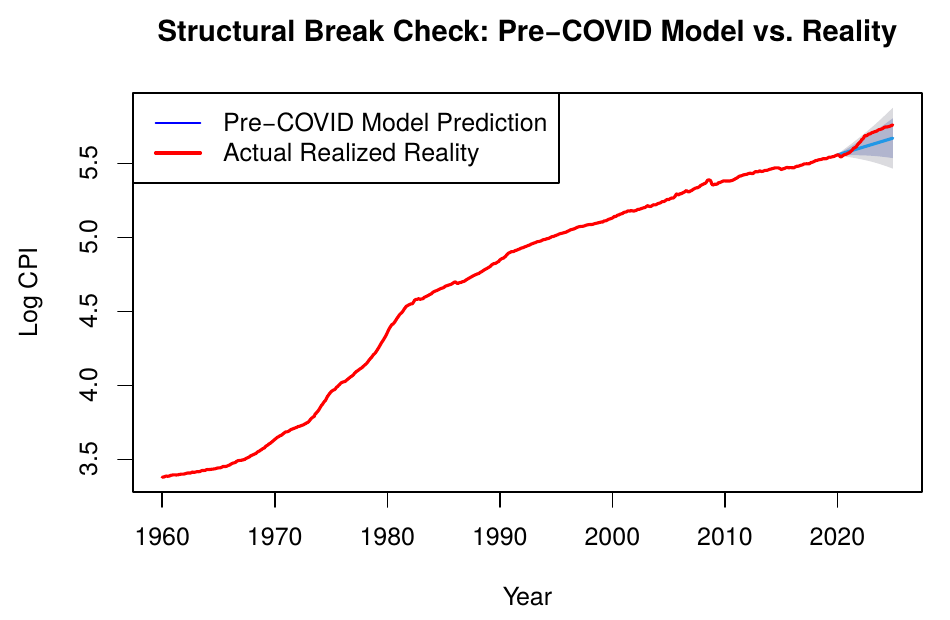
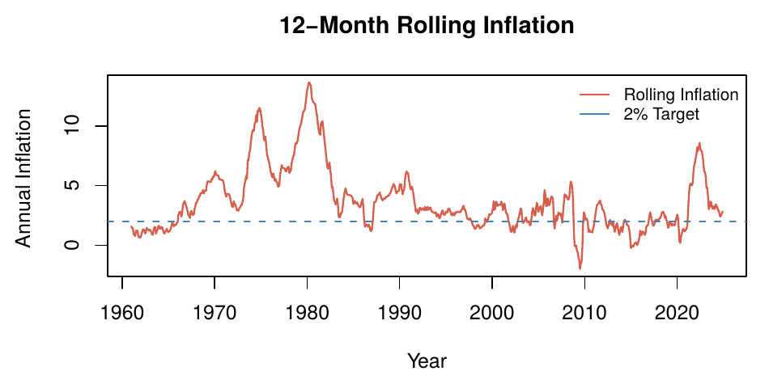

# How Did Historical Inflation Models Miss the COVID-Era Spike?


Did the post-pandemic inflation surge permanently change how U.S. inflation behaves? This project fits SARIMA models to 65 years of monthly CPI data (1960–2024) and asks two questions:

1. How badly would a model trained on pre-COVID history have missed the 2021–2022 spike?
2. Did inflation's underlying dynamics structurally break?



## Key Findings

- **The pre-COVID model missed badly.** An ARIMA(2,2,1)(2,0,0)[12] fit on 1960–2019 data had its 95% prediction interval breached by mid-2021, with a 2020–2024 test RMSE of **0.062** (vs. 0.0023 in training) and a Theil's U of **12.9**.
- **Even with COVID data in training, out-of-sample accuracy collapsed.** Trained through 2022 and tested on 2023–2024, test RMSE rose to **0.0176** (from 0.0024) and Theil's U was **6.59** — worse than a naive no-change forecast.
- **Volatility is time-varying.** A Ljung-Box test on squared residuals (Q = 114.7) shows strong ARCH effects clustered around the 1970s oil shocks, the early 1980s, 2008, and 2020–2022, pointing to GARCH as a natural extension.
- **Forecast:** the final model, refit on all 1960–2024 data, projects roughly **3.3% YoY inflation through 2026**, above the Fed's 2% target.



## Methods

| Step | What was done |
|---|---|
| Data | Monthly CPIAUCSL from FRED, Jan 1960 – Dec 2024 (780 obs), log-transformed |
| Stationarity | ADF + KPSS tests; conflicting results at d = 1 resolved with d = 2 (confirmed by `ndiffs`) |
| Identification | ACF/PACF and raw + smoothed periodograms (no seasonal differencing needed per `nsdiffs`) |
| Model selection | 8 candidates (non-seasonal ARIMA, then SARIMA) compared on AIC, BIC, train/test RMSE, Ljung-Box |
| Diagnostics | Residual ACF, Ljung-Box on residuals and squared residuals (ARCH check) |
| Validation | Train 1960–2022 / test 2023–2024, plus a pre-COVID (≤2019) structural-break test |
| Forecast | 24-month forecast with implied YoY inflation for 2026 |

## Repository Structure

```
├── data/
│   └── CPIAUCSL.xlsx        # FRED CPI data (monthly sheet)
├── report/
│   ├── Report.Rmd           # Written report (R Markdown)
│   └── Report.pdf           # Rendered report
├── analysis/
│   ├── Final.Rmd            # Full working analysis with all code output
│   └── Final.pdf
└── figures/                 # Figures used in this README
```

**Start with [`report/Report.pdf`](report/Report.pdf)** for the full write-up.

## Reproducing

Requires R with these packages:

```r
install.packages(c("readxl", "forecast", "tseries", "zoo", "rmarkdown"))
```

Then knit either `.Rmd` from its own folder (RStudio does this by default), or:

```r
rmarkdown::render("report/Report.Rmd")
```

## Data Source

U.S. Bureau of Labor Statistics, *Consumer Price Index for All Urban Consumers: All Items in U.S. City Average* [CPIAUCSL], retrieved from FRED, Federal Reserve Bank of St. Louis: https://fred.stlouisfed.org/series/CPIAUCSL
